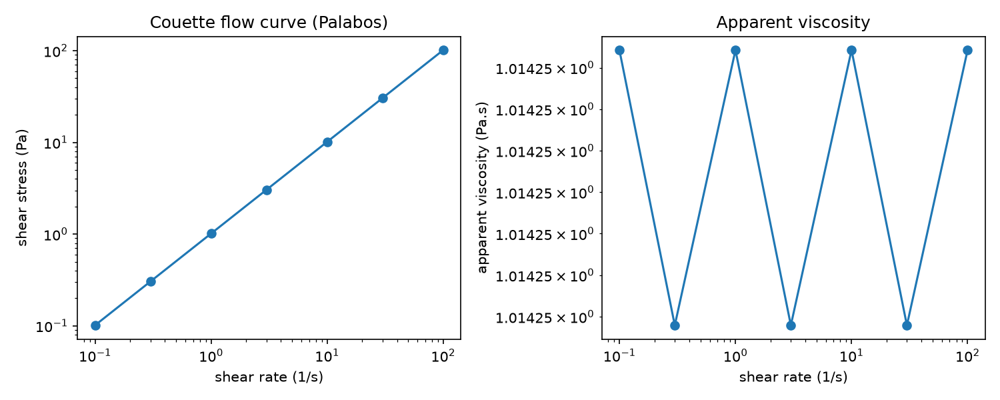
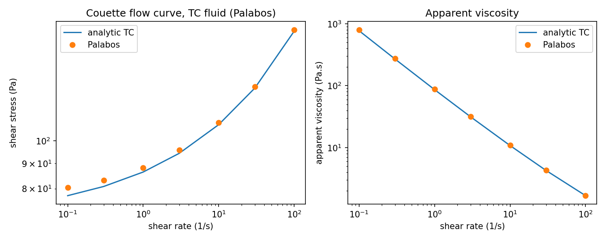

# palabos-skill

Skill teaching an agent to run open-source Palabos lattice Boltzmann
simulations from an English discussion — starting with a Couette
rheometer flow curve. **Public repo. No license needed.**

Palabos (University of Geneva) is a free LBM framework for
general-purpose CFD, AGPLv3, C++ with MPI, "practically no external
dependencies (only Posix and MPI)". This is the open-source
counterpart of the private `mstar-skill` repo: same workflow, same
Couette example, different solver — no license seat, no GUI, no
`.msb` file. Instead you write a small C++ case and compile it.

## Quickstart

```bash
git clone https://github.com/marcocaggioni/palabos-skill.git
cd palabos-skill
uv sync              # Python side only (numpy, matplotlib, pyyaml)
bash scripts/install-palabos.sh   # Palabos C++ — no PyPI package exists for it
bash scripts/check-setup.sh
copilot
```

First prompt:

```
/palabos-simulation run the Couette example in examples/couette/case.yaml
```

Or one go: `copilot -i "Use the /palabos-simulation skill to run the Couette example in examples/couette/case.yaml"`. Copilot must be started from the repo root; if the skill was added mid-session, run `/skills reload`. See `QUICKSTART.md`.

## The workflow

1. **Discuss** in English — geometry, fluid + rheology, sweep, what is measured.
2. **Write `case.yaml`**, show it, get a yes. Never skip this, never invent a number.
3. **Lattice parameters** — `lattice.py` converts physical → lattice units and checks the low-Mach condition. This is the step M-Star hides.
4. **Build** the C++ case (`cmake` + `make`). Dry-run by default.
5. **Sweep / run** — one run per shear rate, torque CSV per run.
6. **Post-process** torque → flow curve, with a mandatory Newtonian validation gate (analytic Couette torque, ~10%).
7. **Report** — plot + CSV + assumptions + validation + unverified items.

## The Couette example

Fluid in a Couette rheometer, inner cylinder rotating, outer fixed,
torque on the bob → flow curve. Defaults (labelled, to confirm):
R_i = 0.020 m, R_o = 0.025 m, L = 0.060 m, Newtonian η = 1.0 Pa·s,
ρ = 1000 kg/m³, γ̇ = 0.1 → 100 s⁻¹ log-spaced, 10 cells across the
gap. 2D cross-section first (torque per unit length); 3D is a
follow-up. Same numbers as the M-Star example, so the solvers can
be compared point for point.

## Results — it ran

<video src="https://raw.githubusercontent.com/marcocaggioni/palabos-skill/main/examples/couette/couette-sweep.mp4" controls></video>

Steady state at each shear rate, γ̇ = 0.1 → 100 s⁻¹. The spin-up at γ̇ = 10 s⁻¹ is in [couette-gamma10.mp4](examples/couette/couette-gamma10.mp4).



Newtonian validation **PASSED**: max analytic-torque error **1.43%**, η_app = 1.0143 Pa·s (true 1.0), constant across the sweep — a systematic staircase-wall bias. Full numbers in [examples/couette/RUN_REPORT.md](examples/couette/RUN_REPORT.md).

## The TC Couette example

Same geometry and sweep, three-component (TC) fluid instead of
Newtonian: τ = σ_y + σ_y√(γ̇/γ̇_c) + η_bg·γ̇ with σ_y = 70 Pa,
γ̇_c = 100 s⁻¹, η_bg = 0.05 Pa·s (50 cP). TC rheology in Palabos
means a local relaxation frequency from the local strain rate
(`TCBGKdynamics`, modelled on Palabos' own `BGKCarreauDynamics`),
with the viscosity capped at η_max = η(10⁻³ s⁻¹) = 7.0221e4 Pa·s
so the unyielded plug is regularized. Because η at the label rate
spans 722 Pa·s (γ̇ = 0.1) down to 1.45 Pa·s (γ̇ = 100), dt is
solved per point at ω = 1.0.

<video src="https://raw.githubusercontent.com/marcocaggioni/palabos-skill/main/examples/couette-tc/couette-tc-sweep.mp4" controls></video>

Steady state at each shear rate, γ̇ = 0.1 → 100 s⁻¹. The spin-up at γ̇ = 10 s⁻¹ is in [couette-tc-gamma10.mp4](examples/couette-tc/couette-tc-gamma10.mp4).



TC validation **PASSED**: max analytic-torque error **3.80%** (at
γ̇ = 0.1, where the yielded zone is only ~2 cells wide), falling to
0.66% at γ̇ = 100 — a systematic positive bias, same staircase-wall
character as the Newtonian +1.43%. At γ̇ ≤ 10 part of the gap is a
genuine unyielded plug attached to the outer wall (R_y = 21.03 mm
at γ̇ = 0.1 up to 24.84 mm at γ̇ = 10); γ̇ ≥ 30 is fully yielded.
Full numbers in [examples/couette-tc/RUN_REPORT.md](examples/couette-tc/RUN_REPORT.md),
code and per-point lattice table in [examples/couette-tc/](examples/couette-tc/).
Caveat: the velocity profile reads high vs analytic (up to ~30%
mid-gap at γ̇ = 10) — the flat TC law amplifies a ~1% stress error
into a large shear-rate error at this resolution; the torque (the
validated quantity) is unaffected. See the run report.

## How this compares

Same Couette case, same validation, five solvers. Full write-up: [docs/comparison.md](docs/comparison.md).

| Solver | Method | Repo | Validation (max error) | η_app | Sweep video |
|---|---|---|---|---|---|
| M-Star | LBM, GPU, licensed | [mstar-skill](https://github.com/marcocaggioni/mstar-skill) (private) | not yet run | — | — |
| Palabos | LBM, C++/MPI, AGPLv3 | [palabos-skill](https://github.com/marcocaggioni/palabos-skill) | 1.43% | 1.0143 | [video](https://github.com/marcocaggioni/palabos-skill/blob/main/examples/couette/couette-sweep.mp4) |
| XLB | LBM, Python/JAX | [xlb-skill](https://github.com/marcocaggioni/xlb-skill) | 1.16% | 0.988–1.000 | [video](https://github.com/marcocaggioni/xlb-skill/blob/main/examples/couette/couette-sweep.mp4) |
| OpenFOAM | Finite-volume, GPL | [openfoam-skill](https://github.com/marcocaggioni/openfoam-skill) | 0.03% | 1.0003 | [video](https://github.com/marcocaggioni/openfoam-skill/blob/main/examples/couette/couette-sweep.mp4) |
| OpenLB | LBM, C++/CUDA, GPLv2 | [openlb-skill](https://github.com/marcocaggioni/openlb-skill) | 0.94% | 1.0093 | [video](https://github.com/marcocaggioni/openlb-skill/blob/main/examples/couette/couette-sweep.mp4) |

## Status — v0.1

- `lattice.py` and `couette_post.py`: **tested in this VM** (lattice
  check passes; post-processing recovers η ≈ 1.0 Pa·s on synthetic
  torque, validation PASSED).
- `couette.cpp`: **compiled and run** against Palabos master
  (commit 4127697, 2026-04-03) on 2026-11-17. Moving wall =
  `VelocityBounceBack` + `setUwall()` ramp; torque = moving-wall
  momentum exchange. Full sweep validated: eta_app = 1.0143 Pa.s
  (true 1.0), analytic torque error 1.43% at every point — see
  `examples/couette/RUN_REPORT.md`, `flow_curve.csv/png`, and the
  videos `couette-gamma10.mp4` / `couette-sweep.mp4`.
- TC fluid (`examples/couette-tc/`): **compiled and run**
  2026-11-17. `TCBGKdynamics` (local omega from the TC law via
  Π^neq, after Palabos' own `BGKCarreauDynamics`); per-point dt
  from the label viscosity; viscosity cap η_max = 7.0221e4 Pa·s.
  Full sweep validated against the analytic TC torque: max error
  3.80% (γ̇ = 0.1) down to 0.66% (γ̇ = 100) — see
  `examples/couette-tc/RUN_REPORT.md`, `flow_curve.csv/png`, and
  the videos `couette-tc-gamma10.mp4` / `couette-tc-sweep.mp4`.
- Still open: 3D (2D cross-section here) and finer resolution
  (the TC velocity profile suggests 10 cells/gap is coarse for
  this fluid — see `examples/couette-tc/RUN_REPORT.md`).

## Files

- `skills/palabos-simulation/SKILL.md` — the skill, mirrored at `.github/skills/palabos-simulation/SKILL.md`
- `docs/palabos-guide.md` — install, build, lattice units, non-Newtonian notes, limits
- `examples/couette/` — the worked Newtonian example
- `examples/couette-tc/` — the worked TC-fluid example
- `scripts/check-setup.sh` — readiness check (copilot, cmake, g++, MPI, Palabos)

Palabos: https://palabos.unige.ch — https://gitlab.com/unigespc/palabos (AGPLv3).
This repo's own code: MIT.
